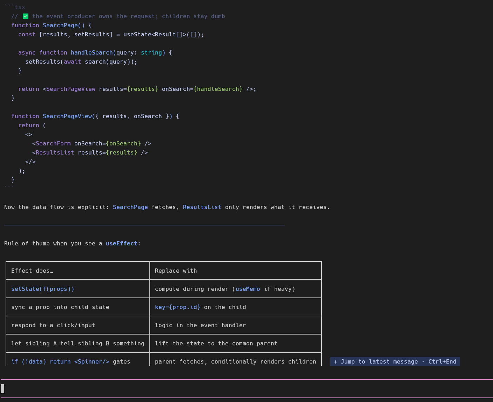

# pi-themes



Popular dark themes for the [Pi](https://pi.dev) coding agent:

| Theme               | Appearance |
| ------------------- | ---------- |
| `tokyo-night`       | dark       |
| `tokyo-night-storm` | dark       |
| `catppuccin-mocha`  | dark       |

Every theme covers the full set of Pi theme roles - interface, messages, tool
panels, markdown, diffs, syntax highlighting, thinking levels and HTML export.

You don't see your favorite theme? [Open a pull request](https://github.com/shivero/pi-themes/pulls)

## Install

```sh
pi install npm:@grzechoo/pi-themes
```

Pin a version with `pi install npm:@grzechoo/pi-themes@0.1.9`.

## Select a theme

In Pi, open `/settings` → **Theme** and pick `tokyo-night`, `tokyo-night-storm`
or `catppuccin-mocha`. Pi saves the choice as `"theme": "<name>"` in
`~/.pi/agent/settings.json`.

For a single run without changing the saved setting:

```sh
pi --use-theme tokyo-night
```

## Install with an agent

The package ships a skill, `install-pi-themes`
(`skills/install-pi-themes/SKILL.md`), so an agent can do the install for you:

```text
/skill:install-pi-themes
```

or simply ask: "install pi-themes and switch me to tokyo-night". The skill
covers checking existing installs, `pi install`, verifying with `pi list`,
selecting the theme (asking you rather than switching silently), the terminal
background, updates and troubleshooting.

## Updating and uninstalling

```sh
pi update npm:@grzechoo/pi-themes   # or: pi update --extensions
```

## Development

Themes are plain Pi theme JSON files, validated against
`https://pi.dev/schemas/theme.schema.json`:

```text
themes/tokyo-night.json
themes/tokyo-night-storm.json
themes/catppuccin-mocha.json
...
```

`tokyo-night-theme.md` is the palette reference the Tokyo themes were mapped
from.

The quickest way to iterate is a local install, which reads this directory
directly:

```sh
pi install /path/to/pi-theme-tokyo-night
```

Edit `themes/*.json`, run `/reload`, and the change appears. A `git:` or npm
install instead copies the package into the agent directory, so edits made here
are not the copy Pi loads.

## Credits

- Tokyo Night palette and role mapping follow [tokyonight.nvim](https://github.com/folke/tokyonight.nvim) by folke (MIT).
- Catppuccin palette follows [catppuccin/nvim](https://github.com/catppuccin/nvim) (MIT).

Neither project is affiliated with this package.

## License

MIT — see [LICENSE](LICENSE).
